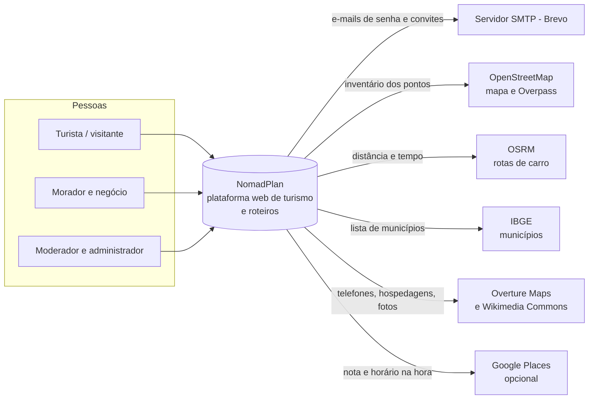
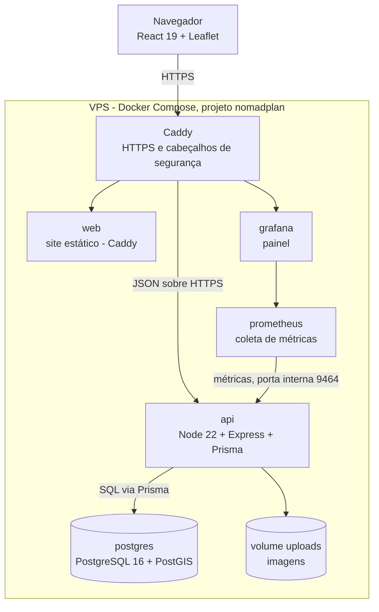

# Arquitetura

Visão em três níveis (modelo C4) do NomadPlan, mais as decisões que mais pesam. Os diagramas estão em texto (Mermaid), então o
GitHub os desenha e eles viajam com o código. As versões em imagem usadas no [RFC](../RFC.pdf) (seção 9) ficam em
[`rfc-imagens/rfc_diagramas`](rfc-imagens/rfc_diagramas). O modelo de dados está em
[dicionario-de-dados.md](dicionario-de-dados.md).

## Nível 1 — Contexto

## Nível 2 — Containers

Em produção os containers rodam numa mesma VPS, com Docker Compose; só um proxy HTTPS (Caddy) fica exposto.

| Container | Tecnologia | Responsabilidade |
| --- | --- | --- |
| web | React 19, TypeScript, Vite (arquivos estáticos) | Telas, rotas protegidas por papel, mapas, sessão e favoritos em contexto |
| api | Node.js 22, Express, TypeScript, Prisma, Zod, JWT | Regras de negócio, autenticação, busca, roteiros, viagem de carro, moderação |
| postgres | PostgreSQL 16 + PostGIS | Dados, busca por raio com índice geográfico, migrações versionadas |
| prometheus e grafana | Prometheus, Grafana | Observabilidade ([monitoramento.md](monitoramento.md)) |

## Nível 3 — Componentes da API

Todo pedido atravessa os middlewares e depois a rota da área; as regras de negócio ficam em módulos de `backend/src/lib`,
independentes do Express e cobertos por testes unitários.

```mermaid
flowchart LR
  req[Requisição] --> mw

  subgraph mw[Middlewares - backend/src/middleware]
    m1[Métricas<br/>Prometheus]
    m2[Helmet e CORS]
    m3[Autenticação JWT<br/>conferida no banco]
    m4[Autorização<br/>por papel]
    m5[Limites de taxa]
    m6[Acesso ao roteiro<br/>por participante]
  end

  mw --> rotas

  subgraph rotas[Rotas - backend/src/routes]
    r1[auth]
    r2[pontos]
    r3[roteiros]
    r4[sugestões e verificações]
    r5[avaliações e salvos]
    r6[admin]
    r7[cidades e convites]
  end

  rotas --> lib

  subgraph lib[Regras de negócio - backend/src/lib]
    l1[recomendacao e horarios<br/>planejador do dia]
    l2[viagemDeCarro e divisaoEmDias<br/>etapas e pernoites]
    l3[buscaPontos<br/>filtros e cache]
    l4[similaridade<br/>gosto parecido]
    l5[seguranca, auditoria e metricasUso]
    l6[osm, overture e municipios<br/>fontes de dados]
  end

  lib --> prisma[(Prisma Client<br/>PostgreSQL)]
```

## Decisões de arquitetura que importam

| Decisão | Por quê |
| --- | --- |
| API sem estado, com JWT conferido no banco a cada requisição | Escala por instâncias; conta desativada ou rebaixada perde o acesso na hora; a versão da sessão invalida tokens após troca de senha |
| Regras de negócio em `lib/`, fora do Express | Testáveis sem subir servidor (testes unitários rápidos) e reutilizáveis |
| PostGIS com índice geográfico | Busca por raio e distância no banco, sem trazer tudo para a memória |
| Dados abertos (OpenStreetMap) guardados no próprio banco | Podem ser armazenados com atribuição; o Google Places é só opcional e só o identificador é gravado |
| Bloqueio otimista (versão) nas edições concorrentes e conferência das notas anteriores | Duas abas ou pessoas não se sobrescrevem em silêncio ([api.md](api.md), `PATCH /roteiros/:id/anotacoes`) |
| A divisão em dias nunca decide um pernoite longe do alvo sozinha | Acima de 100 km do alvo a pessoa aceita ou recusa a cidade proposta |
| Horários sempre no fuso de Brasília, no servidor e na tela | Evita que o relógio do contêiner (UTC) ou do navegador mude o resultado |
| Deploy automático com volta automática | Ver [implantacao-automatica.md](implantacao-automatica.md) |
| Métricas em porta interna | O proxy HTTPS só encaminha a porta da API, então `/metrics` não fica pública ([monitoramento.md](monitoramento.md)) |

## Ambientes

| Ambiente | Como sobe | Banco |
| --- | --- | --- |
| Desenvolvimento | `docker compose up -d` (banco) e `npm run dev` em `backend` e `frontend` | `nomadplan` local |
| Testes | `npm test`; Playwright sobe API e site próprios | `nomadplan_teste` e `nomadplan_e2e` (descartáveis) |
| Produção | Docker Compose na VPS, implantado pelo GitHub Actions ([passo a passo](implantacao-automatica.md)) | `nomadplan` na VPS, com backup antes de cada implantação |
