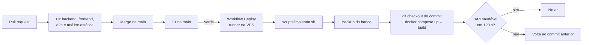

# Implantação automática (CI/CD)

A cada merge na `main` com o CI verde, o GitHub Actions implanta o mesmo commit na VPS. **Não há deploy manual por SSH**: a própria
VPS busca o trabalho por meio de um *runner* do GitHub instalado nela, então não é preciso abrir SSH de fora para dentro nem
guardar chave da VPS no GitHub. Atende ao RNF24 (volta automática) e ao núcleo comum de engenharia (CI/CD).

## Como funciona



1. O workflow **CI** (`.github/workflows/ci.yml`) roda tipos, build, lint, testes com cobertura, auditoria de dependências, Playwright
   e a análise estática.
2. Passando na `main`, o workflow **Deploy** (`.github/workflows/deploy.yml`) roda no runner da VPS e chama
   `scripts/implantar.sh <commit>`.
3. O script tira um **backup** do banco, coloca o código no commit pedido e reconstrói os contêineres com o Docker Compose. As
   migrações do Prisma rodam sozinhas quando a API sobe.
4. Ele espera `GET /health` responder dentro do contêiner. Se não responder em 120 s, **volta para o commit que estava no ar**,
   reconstrói e termina com erro (o workflow fica vermelho).
5. Por fim o workflow confere o endereço público (`https://api.nomadplan.blackyears.com.br/health`).

## Voltar de versão (rollback manual)

No GitHub: *Actions → Deploy → Run workflow*, informe o **commit anterior** (os últimos aparecem em *Commits*). O mesmo
script implanta aquele commit. Importante: as migrações só andam para frente; a volta de código funciona porque elas só
acrescentam colunas e tabelas. Em caso extremo, restaure o backup tirado antes da implantação (`backups/`, `scripts/restaurar.sh`).

## Segurança do runner

O runner roda numa máquina de produção, então o workflow só dispara de dois jeitos: **CI concluído de um push na própria `main`
deste repositório** (nunca de pull request nem de fork) ou **manualmente por quem tem permissão de escrita**. Em *Settings →
Actions → General*, deixe *Fork pull request workflows* exigindo aprovação. O usuário do runner não tem sudo.

## Instalando o runner na VPS (uma vez)

Como `root` na VPS:

```bash
# 1. Usuário só para o runner, com acesso ao Docker e à pasta do projeto
adduser --disabled-password --gecos "" runner
usermod -aG docker runner
chown -R runner:runner /opt/nomadplan
sudo -u runner git config --global --add safe.directory /opt/nomadplan

# 2. O arquivo de segredos só é lido por quem implanta
chown runner:runner /opt/nomadplan/.env.prod && chmod 600 /opt/nomadplan/.env.prod
```

No GitHub: *Settings → Actions → Runners → New self-hosted runner* (Linux, x64). A página mostra os comandos de download e de
configuração com um **token temporário**: não o compartilhe com ninguém. Rode-os como o usuário `runner` (`su - runner`). Na etapa
`./config.sh`, use:

- *Runner group*: o padrão;
- *Labels*: `nomadplan-vps`;
- nome: `vps-hostinger`.

Depois, ainda como `root`, instale como serviço para subir sozinho:

```bash
cd /home/runner/actions-runner
./svc.sh install runner
./svc.sh start
./svc.sh status
```

Em *Settings → Environments*, crie o ambiente **producao** (o workflow o referencia). Se quiser, exija sua aprovação manual ali.

## Verificar

- *Actions → Deploy* mostra a execução, com a saída do script (`No ar: abc1234. Implantando: def5678.`).
- `docker compose -p nomadplan ... ps` com tudo saudável e `curl https://api.nomadplan.blackyears.com.br/health` com `ok`.
- Teste a volta automática numa janela segura: implante um commit com um erro de inicialização e veja o script voltar ao anterior.

## Arquivos

| Arquivo | Para quê |
| --- | --- |
| `.github/workflows/deploy.yml` | Quando e onde implantar |
| `scripts/implantar.sh` | Backup, checkout, build, verificação de saúde e volta automática |
| `scripts/backup.sh`, `scripts/restaurar.sh` | Backup e restauração do banco e das imagens |
| `docker-compose.prod.yml`, `docker-compose.compartilhado.yml`, `docker-compose.monitoramento.yml` | O que sobe na VPS |
